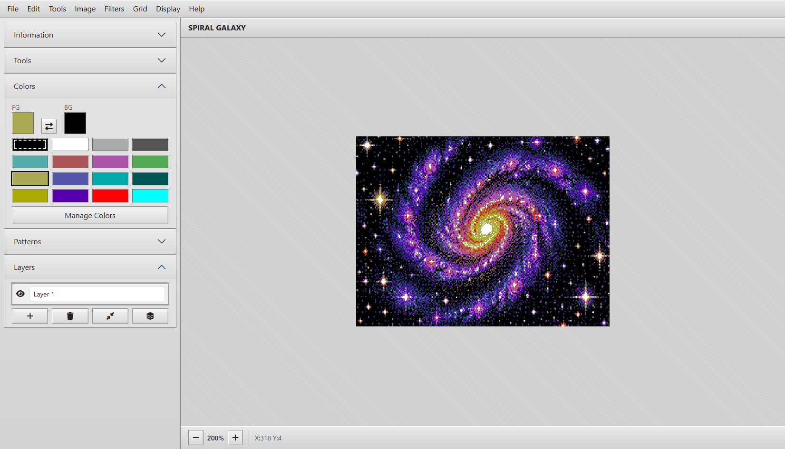
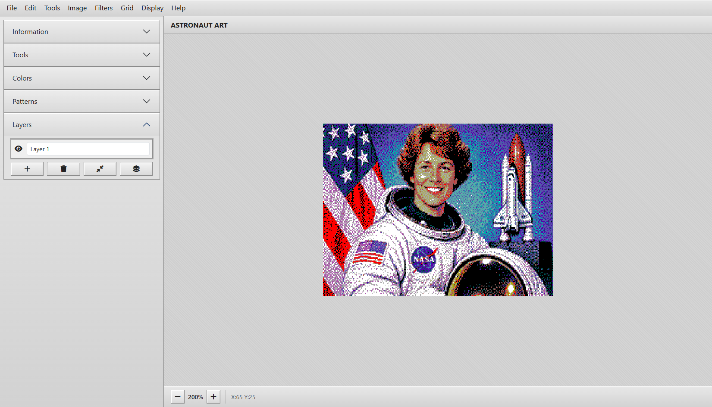
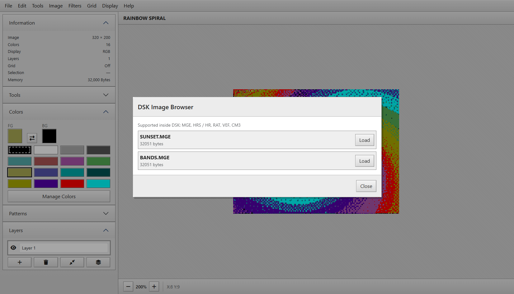
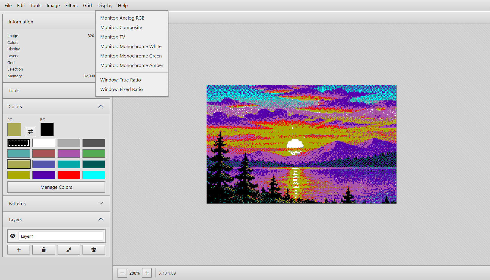

# Kroma Paint v1.0.8

Kroma Paint is a retro indexed paint editor for TRS-80 Color Computer 3 workflows.

It is designed for CoCo 3 game developers who want a desktop-style paint program with indexed palettes, editable patterns, layers, grid tools, DSK browsing, and export options that are useful for both modern development and retro-targeted asset creation.

## Screenshots

## Main features
- CoCo 3 indexed image editing
- 2, 4, and 16 color workflows
- Multiple CoCo-style resolutions, including 192/200/225 line variants
- Foreground color painting or pattern painting
- Editable 16-slot palette
- Palette presets, save, and load
- Editable 16-pattern library plus themed pattern sets
- Layers with visibility, rename, merge down, and flatten
- Selection, fixed selection, stamp, fill, shapes, text, brush, spray, and eraser tools
- Grid display and snap to grid
- CoCo image and DSK browsing for supported formats
- Export dialog for PNG, BMP, and raw indexed data
- Bootstrap 5 UI with a MacPaint-inspired theme

## Notes
- Direct write-back into DSK images is still limited in this build.
- Export dialog is in place, but CoCo-native container export remains partial.
